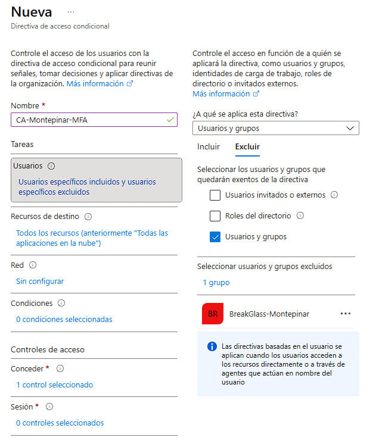
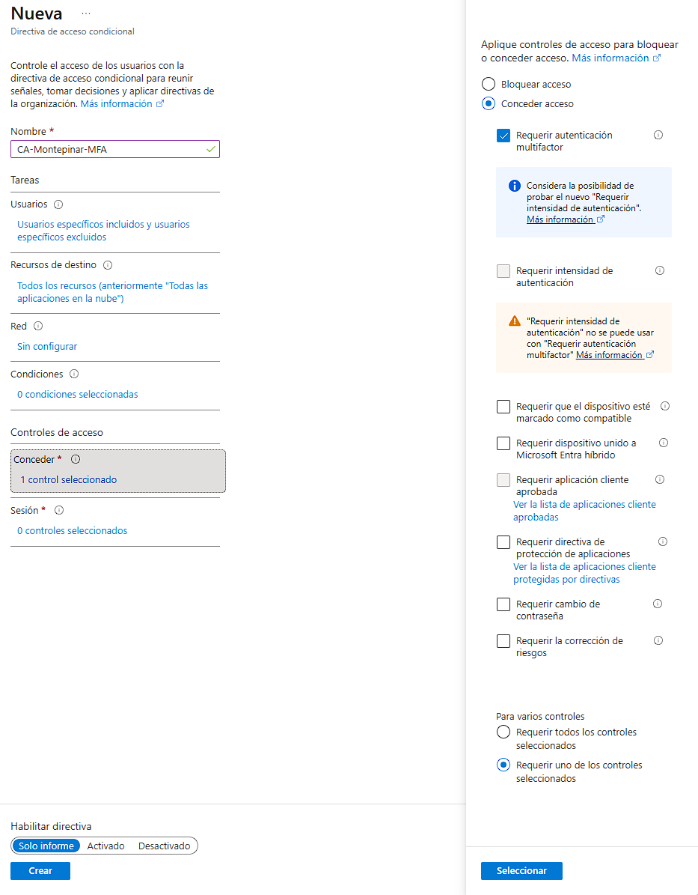
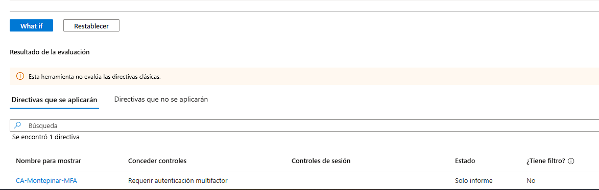
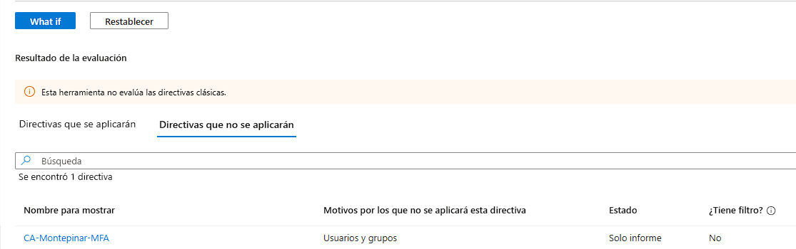
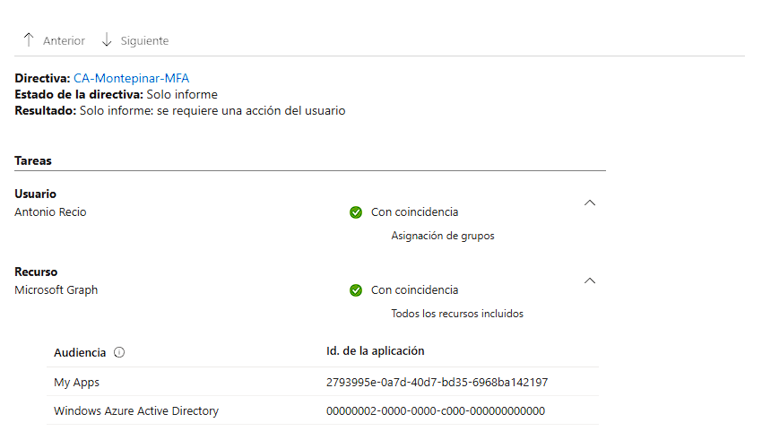
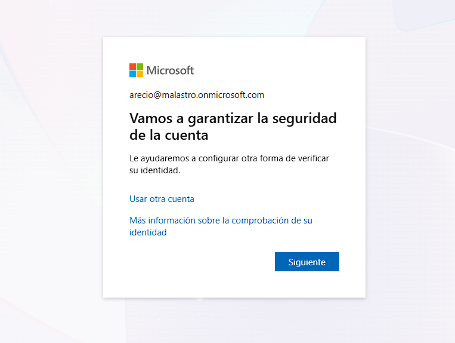

# Lab_02: MFA en Microsoft Entra ID — Operación Moroso

## 1. Descripción del proyecto
Tras desplegar la infraestructura de identidad híbrida de Mirador de Montepinar SL, Antonio Recio ha decidido que ya no se puede fiar ni de sus propios vecinos.

Con el moroso de la comunidad todavía en paradero desconocido, Antonio quiere evitar que alguien pueda hacerse pasar por otro vecino para acceder a los recursos de la empresa. Para ello, encarga la implementación de la autenticación multifactor (MFA) en Microsoft Entra ID.

El objetivo de este laboratorio es configurar y validar una política de acceso condicional que requiera MFA, preparar cuentas de emergencia para reducir el riesgo de bloqueo administrativo (tenant lockout) y comprobar el comportamiento de las políticas mediante herramientas de simulación lógica (What If) y telemetría forense en los registros de auditoría de inicio de sesión.

### Objetivos técnicos:
- Revisar la configuración de seguridad y autenticación del inquilino de Microsoft Entra ID.
- Crear y gobernar cuentas de emergencia Break-Glass independientes de la infraestructura local.
- Configurar una política de acceso condicional orientada a arquitectura Zero Trust que exija MFA.
- Evaluar el alcance y las exclusiones de la política mediante la herramienta de inferencia What If.
- Auditar el impacto inicial de la directiva en modo Solo informe (Report-only) mediante el análisis de Sign-in logs.
- Promover la directiva a estado Activado y validar la interrupción del acceso en vivo.

**Escenario ficticio:** Mirador de Montepinar SL, donde Antonio Recio quiere controlar quién entra en el sistema casi tanto como quién debe las cuotas de la comunidad.

---

## 2. Fases de implementación

### Fase 1. Preparación del entorno e identidades de prueba
Se reutilizó el entorno de identidad híbrido desarrollado en el *Lab 01: Despliegue de Identidad Híbrida*.

El laboratorio utiliza las identidades de prueba del directorio local sincronizadas con Microsoft Entra ID mediante Entra Connect (PHS). Sobre esta base se configuraron los controles de acceso y las medidas de protección de las identidades corporativas.

---

### Fase 2. Cuentas de emergencia Break-Glass
Para reducir el riesgo de perder el acceso administrativo al inquilino ante una incidencia con las políticas de autenticación o acceso condicional, se crearon dos cuentas de emergencia nativas de la nube (*cloud-only*): `bg-conserje1` y `bg-conserje2`.

Ambas cuentas se configuraron con el rol de **Administrador global** de asignación permanente y se agruparon en `BreakGlass-Montepinar`, grupo destinado a centralizar su exclusión de las políticas de acceso condicional.

> **Consideraciones de seguridad:** las cuentas de emergencia deben disponer de credenciales protegidas, almacenamiento seguro, supervisión de los inicios de sesión y revisiones periódicas. Su exclusión de una política concreta no las exime automáticamente de las demás políticas del tenant

---

### Fase 3. Configuración de la política de acceso condicional
Se creó la política `CA-Montepinar-MFA` para exigir autenticación multifactor a las identidades directivas de la organización bajo un modelo Zero Trust.

**Parámetros de la directiva:**
* **Usuarios incluidos:** Grupo `Directiva-Montepinar`.
* **Usuarios excluidos:** Grupo `BreakGlass-Montepinar` *(Mitigación de bloqueo administrativo)*.
* **Recursos de destino:** Todas las aplicaciones en la nube (*Todos los recursos*).
* **Control de concesión:** Conceder acceso > Requerir autenticación multifactor.
* **Estado inicial:** Solo informe (*Report-only*).
  
La exclusión de las cuentas de emergencia busca reducir el riesgo de bloqueo administrativo provocado por esta política concreta.

| Exclusión Cuentas Break-Glass | Control de Concesión y Modo Informe |
| :---: | :---: |
|  |  |

---

### Fase 4. Validación, simulación y despliegue

#### 1. Simulación con la Herramienta What If
Se utilizó la herramienta What If de Microsoft Entra ID para evaluar la aplicación de la política de Acceso Condicional a distintas identidades y comprobar el efecto de las inclusiones y exclusiones configuradas sobre dos sujetos diferentes:

* **Caso 1: Antonio Recio (`arecio`)**  
  La directiva `CA-Montepinar-MFA` se evalúa como aplicable, exigiendo el cumplimiento del control MFA.
* **Caso 2: Cuenta de emergencia (`bg-conserje1`)**  
  La directiva se descarta por coincidencia con la regla de exclusión por pertenencia a grupos.

| Caso1: Evaluación Antonio Recio (MFA Requerido) | Caso 2: Evaluación Break-Glass (Exclusión Validada) |
| :---: | :---: |
|  |  |
| La evaluación indicó que la política CA-Montepinar-MFA era aplicable a la identidad de prueba (arecio) y que requería MFA. | La evaluación indicó que la política se omitía debido a la exclusión configurada para el grupo BreakGlass-Montepinar.

#### 2. Auditoría en Registros de Inicio de Sesión (Sign-in Logs)
Manteniendo la directiva en modo **Solo informe**, se realizó un inicio de sesión interactivo con las credenciales de Antonio Recio en `https://myapplications.microsoft.com`.

La inspección forense en los *Sign-in logs* confirmó que el usuario y el recurso coincidieron con las condiciones fijadas, y el control de concesión devolvió el veredicto **«Solo informe: se requiere una acción del usuario»** (*Acción del usuario requerida*), confirmando que la directiva opera según lo previsto sin interrumpir la operativa real del usuario.

#### 3. Activación y validación del requisito de MFA
Una vez verificada la telemetría, la directiva se promovió al estado **Activado**.  
Tras activar la política, se realizó una prueba de inicio de sesión con la cuenta de Antonio Recio. Al no disponer todavía del método multifactor registrado, el flujo de autenticación solicitó completar el registro de la información de seguridad antes de continuar. Esta prueba permitió comprobar el efecto de exigir MFA sobre una identidad que aún no había completado el registro. (*«Vamos a garantizar la seguridad de la cuenta»*).

---

## 3. Resultados y consideraciones de seguridad
El laboratorio permitió configurar y evaluar una política de Acceso Condicional que exige MFA, preparar cuentas de emergencia y comprobar el comportamiento de la política antes y después de su activación.

Las principales tareas realizadas fueron:
- Preparación de identidades híbridas y cuentas de emergencia Break-Glass.
- Configuración de una política de Acceso Condicional con grupos de inclusión y exclusión.
- Evaluación de la política mediante What If.
- Análisis de los registros de inicio de sesión durante la fase de Report-only.
- Activación de la política en el entorno de laboratorio y validación del flujo de registro de MFA.

---

## 4. Posibles mejoras futuras
- Endurecer los métodos de autenticación mediante la activación de directivas anti-fatiga de MFA (*Number Matching*, contexto geográfico y de aplicación en Microsoft Authenticator).
- Explorar métodos de autenticación resistentes al phishing, como credenciales FIDO2 o Passkeys.
- Diseñar alertas automáticas en Azure Monitor / Log Analytics que disparen notificaciones inmediatas ante cualquier uso de las cuentas `BreakGlass-Montepinar`.
- Extender el alcance de la directiva evaluando condiciones de riesgo de usuario e inicio de sesión con Microsoft Entra ID Protection.
