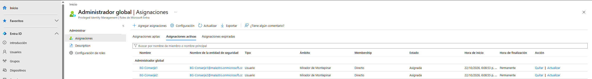

# Lab 02: MFA en Microsoft Entra ID — Operación Moroso

## 1. Descripción del proyecto

Tras desplegar la infraestructura de identidad híbrida de Mirador de Montepinar SL, Antonio Recio ha decidido que ya no se puede fiar ni de sus propios vecinos.

Con el moroso de la comunidad todavía en paradero desconocido, Antonio quiere evitar que alguien pueda hacerse pasar por otro vecino para acceder a los recursos de la empresa. Para ello, encarga la implementación de la autenticación multifactor (MFA) en Microsoft Entra ID.

El objetivo de este laboratorio es configurar y validar una política de acceso condicional que requiera MFA, preparar cuentas de emergencia para reducir el riesgo de bloqueo administrativo y comprobar el comportamiento de las políticas mediante las herramientas de evaluación y los registros de autenticación.

**Objetivos técnicos:**

- Revisar la configuración de seguridad y autenticación del tenant de Microsoft Entra ID.
- Crear cuentas de emergencia independientes de la infraestructura local.
- Configurar una política de acceso condicional que requiera MFA.
- Evaluar el alcance y las exclusiones de la política mediante la herramienta What If.
- Probar la política inicialmente en modo *Report-only* y, posteriormente, activarla.
- Documentar los resultados obtenidos y las consideraciones de seguridad del laboratorio.

**Escenario ficticio:** Mirador de Montepinar SL, donde Antonio Recio quiere controlar quién entra en el sistema casi tanto como quién debe las cuotas de la comunidad.

## 2. Fases de implementación

### Fase 1. Preparación del entorno e identidades de prueba

Se reutilizó el entorno de identidad híbrida desarrollado en el [Lab 01: Despliegue de Identidad Híbrida](https://github.com/Malastro/Hybrid-identity-lab).

El laboratorio utiliza las identidades de prueba del directorio local sincronizadas con Microsoft Entra ID. Sobre esta base se configuraron los controles de acceso y las medidas de protección de las cuentas administrativas.

### Fase 2. Cuentas de emergencia Break-Glass

Para reducir el riesgo de perder el acceso administrativo al tenant ante una incidencia con las políticas de autenticación o acceso condicional, se crearon dos cuentas de emergencia nativas de la nube (*cloud-only*): `bg-conserje1` y `bg-conserje2`.

Las cuentas se configuraron con el rol de Administrador Global y se agruparon en `BreakGlass-Montepinar`, utilizado para gestionar su exclusión de la política de acceso condicional del laboratorio.

Esta configuración busca mantener una vía de acceso de emergencia independiente de la infraestructura local y reducir el riesgo de bloqueo administrativo.

**Consideraciones de seguridad:** las cuentas de emergencia deben contar con credenciales protegidas, supervisión de los inicios de sesión y pruebas periódicas. Su exclusión de una política concreta no las excluye automáticamente de las demás políticas del tenant.

### Fase 3. Configuración de la política de acceso condicional

Se creó la política `CA-Montepinar-MFA` para exigir autenticación multifactor a las identidades incluidas en su ámbito.

**Configuración de la política:**

- **Usuarios incluidos:** grupo `Directiva-Montepinar`.
- **Usuarios excluidos:** grupo `BreakGlass-Montepinar`.
- **Recursos de destino:** todas las aplicaciones en la nube.
- **Control de concesión:** requerir autenticación multifactor.

La exclusión de las cuentas de emergencia se configuró para evitar que esta política concreta impidiera su utilización durante una incidencia administrativa.

### Fase 4. Validación y despliegue de la política

Antes de activar la política, se utilizó el modo *Report-only* para evaluar su posible impacto sin aplicar el requisito de acceso como una condición bloqueante.

Posteriormente, se utilizó la herramienta **What If** de Microsoft Entra ID para comprobar cómo se evaluaba la política con diferentes identidades.

**Caso 1. Antonio Recio (`arecio`)**

La evaluación indicó que la política `CA-Montepinar-MFA` se aplicaba a la identidad de prueba y requería MFA.

**Caso 2. Cuenta de emergencia (`bg-conserje1`)**

La evaluación mostró que la política se omitía debido a la exclusión explícita de las cuentas de emergencia.

Una vez realizadas estas comprobaciones, la política se cambió al estado **Activado**.

Se efectuó una prueba de inicio de sesión con la cuenta de Antonio Recio para comprobar el comportamiento del acceso tras la activación. La exigencia de MFA se verificó en el contexto de la política configurada.

### Fase 5. Resultados y consideraciones de seguridad

El laboratorio permitió configurar y evaluar una política de acceso condicional que exige MFA, establecer exclusiones explícitas para las cuentas de emergencia y comprobar el comportamiento esperado de la política mediante What If.

El despliegue siguió este flujo de trabajo:

1. Preparación de las identidades y las cuentas de emergencia.
2. Configuración de la política de acceso condicional.
3. Evaluación inicial en modo *Report-only*.
4. Comprobación del alcance y las exclusiones mediante What If.
5. Activación de la política y prueba de inicio de sesión.

**Consideraciones adicionales:**

- La exclusión de las cuentas Break-Glass debe revisarse en el contexto de todas las políticas del tenant.
- Las cuentas de emergencia deben protegerse, monitorizarse y probarse periódicamente.
- What If permite evaluar el comportamiento previsto de una política, pero no sustituye a las pruebas reales ni al análisis de los registros de inicio de sesión.
- La protección contra ataques de *MFA fatigue* y el uso de métodos de autenticación resistentes al phishing son posibles ampliaciones futuras del laboratorio.

## 3. Posibles mejoras futuras

- Explorar métodos de autenticación resistentes al phishing, como passkeys o claves FIDO2, si están disponibles en el entorno.
- Revisar y documentar los métodos de autenticación permitidos para los usuarios.
- Analizar los registros de inicio de sesión y las evaluaciones de acceso condicional para investigar resultados inesperados.
- Ampliar las pruebas con diferentes usuarios, aplicaciones y condiciones de acceso.
- Documentar procedimientos de supervisión y revisión periódica de las cuentas de emergencia.
